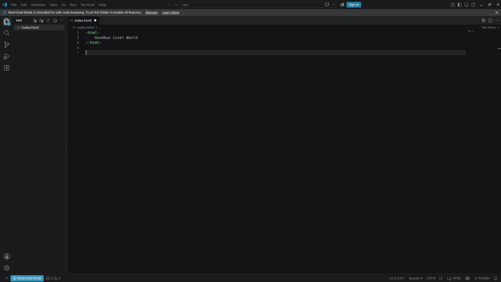

import { Tabs, TabItem } from '@astrojs/starlight/components';

Let me introduce the IDE. IDE stands for Integrated Development Environment, where you get all the tools you need to build software in one place.
More importantly, you can customize it to LARP being a hand coder in the AI age. However, to be completely honest with you, you probably wont need to use an IDE in the future.
Everyones on Claude code now lol. But still, having all the tools in one place will make your learning journey much more easier and thats what we are here for.

:::note
I actually use something called [Neovim](https://neovim.io/) to write this tutorial! Pure LARP. I don't even use it at work LOL. Don't use it please. You will not save any more time by not having to use a mouse.
:::

Our IDE of choice here is Visual Studio Code otherwise known as VS Code. It was the most used IDE globally before AI coding when mainstream. 
Start by downloading and installing [here](https://code.visualstudio.com/download)

Once it has finished installing, open the folder which you created in the first unit.
Currently that folder only contains the file index.html.
Click on index.html to open it.
It should now look something like this.

Now right of the bat thats a massive improvement from the text editor we used previously. For starters we have a lovely dark theme.
Ok next lets install an extension.
Open up the extensions tab

<Tabs>
    <TabItem label="Windows">`Ctrl + Shift + X`</TabItem>
    <TabItem label="macOS">`Cmd + Shift + X`</TabItem>
</Tabs>

Next, search for the ["Live Server"](https://marketplace.visualstudio.com/items?itemName=ritwickdey.LiveServer) extension by Ritwick Dey. Install it.

auto save
