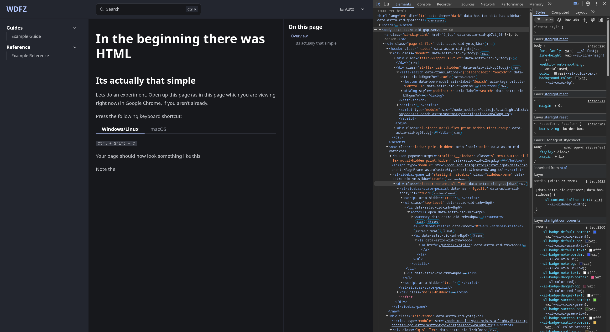

import { Tabs, TabItem } from '@astrojs/starlight/components';
import { LinkCard } from '@astrojs/starlight/components';

### Its actually that simple
Lets do an experiment. Open up this page (as in this page which you are viewing right now) in Google Chrome, if you aren't already.

Press the following keyboard shortcut:

<Tabs>
  <TabItem label="Windows/Linux">`Ctrl + Shift + C` </TabItem>
  <TabItem label="macOS">`Cmd + Option + C`</TabItem>
</Tabs>

This opens the inspector to the elements tab. (Don't worry what this means for the time being!)

Your page should now look something like this:


Note the that on the left we have this page, and on the right we have a bunch of scary looking gibberish, this is the inspector!

At the top of the inspector we have a few tabs, if pressed the keyboard shortcuts mentioned above, the current tab should be the elements tab.

If you take a look at the gibberish in the elements tab. It should look something like this:
```html
<html>
<!-- a bunch of gibberish -->
```
then at the bottom, you might have to scroll down a bit to see it but then end should look like this

```html
<!-- a bunch of gibberish -->
</html>
```
Ok whatever, this is meaningless at the moment. Now, you the reader, please go to any other website of your choosing, and open the elements tab again.

You should also see the same gibberish:
```html
<html>
    <!-- a bunch of gibberish -->
</html>
```

Wait a minute! They both have `<html>` at the start, a bunch of gibberish in the middle and `</html>` at the end!

Try with any page you like (I hope you believe me by now), you should see the exact same thing!

And that my friends, is all there is to web development. It's just writing `<html>` `</html>` and a bunch of gibberish in between. 

The difficult part, my friend, is deciding what gibberish to write.

But the point I'm trying to demonstrate here, is that all web pages are made of the exact same ingredients, even YouTube and Instagram are made of the exact same ingredients. And you, dear reader, can learn the ingredients as well!

<LinkCard title="So what the hell is HTML???" href="/html/tags" />

