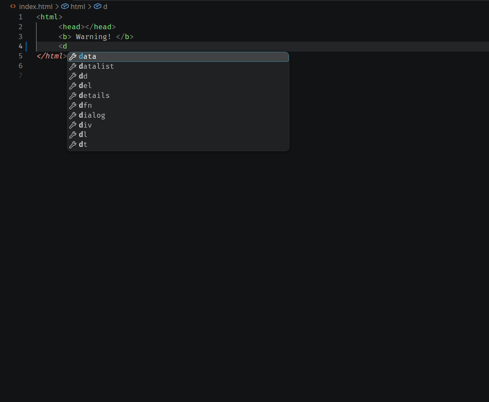
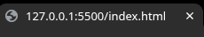
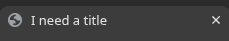
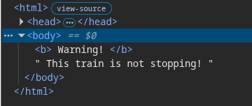
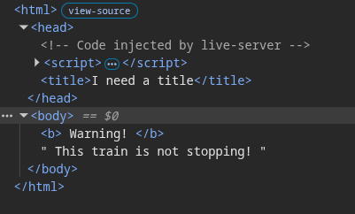

What are tags? Tags are the building blocks of HTML. To put it simply, tags consist of:
an opening angle bracket: `<`
text i.e `html`
and a closing angle branch: `>`

`< {some text} >`

and we use this to tell the browser how to read and display our page.

So yes, you have actually already written your first tag!

Remember `<html>`??

Thats a tag!

But hey you might ask, I remember that tag but why do we have a similar tag at the end of the page that looks like `</html>`? 

Great question, well the only difference is the `/` placed before the `html` text. That is what we call a closing tag. For example `<html>` would be the opening tag and `</html>` would be its corresponding closing tag.

So why do we need opening and closing tags in the first place?

You may think of tags like a railway. The opening tag is the first station, everything in between is railway track and the closing tag is the last station. The browser is like a train. If you don't include a closing tag, the train (browser) keep going and doesn't stop for passengers!

# INCLUDE A DIAGRAM HERE

Ok that was maybe a bit abstract. Let me illustrate with a real example in HTML. Change the `index.html` to the following!

```diff lang="html"
<html>
     <head></head>
-     Hello World
+     Warning! This train is not stopping!
</html>

```
Let's say we want to make only the text "Warning!" to be bold so it should look something like this:

**Warning!** This train is not stopping!

So lets add the following to our `index.html` file:

```diff lang="html"
<html>
     <head></head>
-    Warning! This train is not stopping!
+    <b> Warning! This train is not stopping!
</html>

```

I added the `<b>` tag before the `Warning!` since that's the word we want to make bold. We will go over what the `<b>` tag does later on, for now just follow along.

Let's look at the web page.


Hmmm...interesting! The entire text is bold, not just the "Warning!" text.

Following our train analogy from above, the web browser does not know when you want to stop, so it just applies the bold styling to all of the text after the `<b>` tag.

Now add a closing `</b>` tag.

```diff lang="html"
<html>
     <head></head>
-    <b> Warning! This train is not stopping!
+    <b> Warning! </b> This train is not stopping!
</html>

```
Looks like it's correct now!


We told the browser we want the "bold text train" to stop after the "Warning!" text and it did indeed! I hope this illustrates the importance of closing tags!

:::note
Observant readers might note that VS Code already inserts closing pairs for us by default.
Simply typing a tag like `<b>` after tying the `>` closing bracket, the corresponding closing tag `</b>` is inserted right after. How convenient!

Not only that VS Code automatically suggests tags on typing `<` and a letter!



Back in the day, before AI coding, this was considered magic already LOL
:::

### Actually learning about tags now
So we have a *MAJOR* problem! Looking at our webpage in a web browser, we have a very ugly title.



We cannot consider ourselves serious developers if we do not have a cool title.

Luckily there is an HTML tag to help us with this issue, allow me to introduce...the `title` tag!

The `title` tag follows the same format we mentioned above. The opening tag `<` + `title` + `>` and the closing tag `<` + `/` + `title` + `>` .

To use, simply add to an HTML page `<title>{any text you want as your title}</title>`

So if we wanted our page to have the title: `I need a title`

We would write add `<title>I need a title</title>`

!!! QUIZ

Lets add it to our page.

```diff lang="html"
<html>
     <head></head>
+    <title>I need a title</title>
     <b> Warning! </b> This train is not stopping!
</html>

```

Now our page has a cool title!



Lets open up the Elements tag in the inspector to check what the browser reads.



That's weird. Where did our title tag go? Why doesn't it look like the HTML we wrote? Toggle open the `<head>` tag and you should see this.



That's interesting the browser has automatically moved our `<title` tag into the `<head>` tag! Not just that, the browser has automatically inserted a `<body` tag for us?????

This is probably a good time for me to introduce another set of tags: `<head>` and `<body>`

### Head shoulders knees and toes

The `<head>` tag is a container for page metadata and `<body>` tag is a container for page content.

Ok that doesn't really mean anything.

To put it simply, the stuff we want the user to see on the page, is placed between the  `<body>`  `</body>` tags.

And everything that goes on behind the scenes, is placed between `<head>` `</head>`.

But didn't the browser just do everything for me just now? Why do I have to add it myself?

The browser isn't magic (actually it is but not in that sense), it simply reads your HTML and outputs the content based on a set of pre defined rules.

Since our example is super tiny so its quite easy for the browser to guess correctly, but when we have thousands of tags the browser might not be able to guess correctly.

But there's actually a more practical reason for following the HTML rules. 

## NEED AN EXAMPLE OF READING THE HEAD METADATA TO EMBED LOL

Ok so we know its pretty important, but if we had to write all of that before we even start building our site, it would be very annoying. (I think you know where I'm going with this.)

Luckily for us, developers before us have been tortured by this issue as well and have created a shortcut in VS Code for us.

Delete everything in our `index.html`. EVERYTHING!

If we type a single `!` in VS Code. You should see the following:

[emmet autocompelte]


