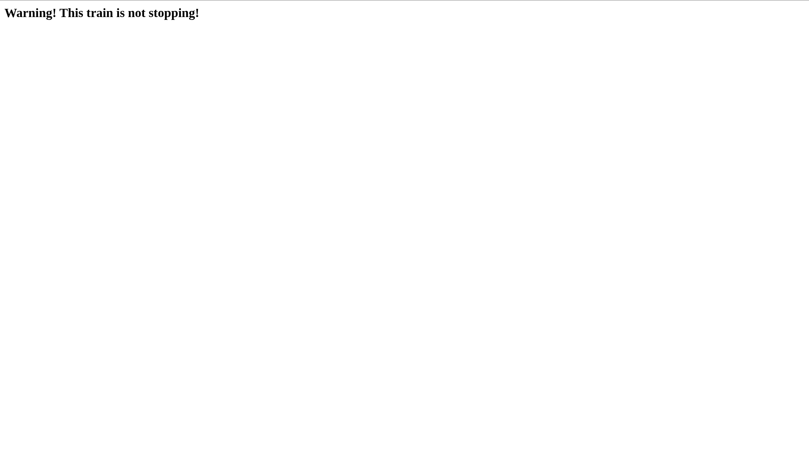

What are tags? Tags are the building blocks of HTML. To put it simply, tags consist of:
an opening angle bracket: `<`
text i.e `html`
and a closing angle branch: `>`

`< {some text} >`

and we use this to tell the browser how to read and display our page.

So yes, you have actually already written your first tag!

Remember `<html>`??

Thats a tag!

But hey you might ask, I remember that tag but why do we have a similar tag at the end of the page that looks like `</html>`? 

Great question, well the only difference is the `/` placed before the `html` text. That is what we call a closing tag. For example `<html>` would be the opening tag and `</html>` would be its corresponding closing tag.

So why do we need opening and closing tags in the first place?

You may think of tags like a railway. The opening tag is the first station, everything in between is railway track and the closing tag is the last station. The browser is like a train. If you don't include a closing tag, the train (browser) keep going and doesn't stop for passengers!

# INCLUDE A DIAGRAM HERE

Ok that was maybe a bit abstract. Let me illustrate with a real example in HTML. Change the `index.html` to the following!

```diff lang="html"
<html>
     <head></head>
-     Hello World
+     Warning! This train is not stopping!
</html>

```
Let's say we want to make only the text "Warning!" to be bold so it should look something like this:

**Warning!** This train is not stopping!

So lets add the following to our `index.html` file:

```diff lang="html"
<html>
     <head></head>
-    Warning! This train is not stopping!
+    <b> Warning! This train is not stopping!
</html>

```

I added the `<b>` tag before the `Warning!` since that's the word we want to make bold. We will go over what the `<b>` tag does later on, for now just follow along.

Let's look at the web page.



Hmmm...interesting! The entire text is bold, not just the "Warning!" text.

Following our train analogy from above, the web browser does not know when you want to stop, so it just applies the bold styling to all of the text after the `<b>` tag.

Now add a closing `</b>` tag.

```diff lang="html"
<html>
     <head></head>
-    <b> Warning! This train is not stopping!
+    <b> Warning! </b> This train is not stopping!
</html>

```
Looks like it's correct now!


We told the browser we want the "bold text train" to stop after the "Warning!" text and it did indeed! I hope this illustrates the importance of closing tags!

### Actually learning about tags now


### auto pairs somehow in the future


